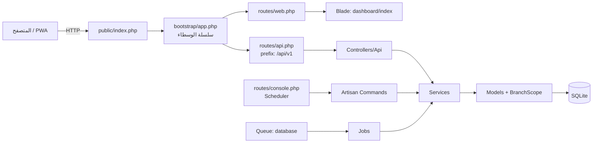
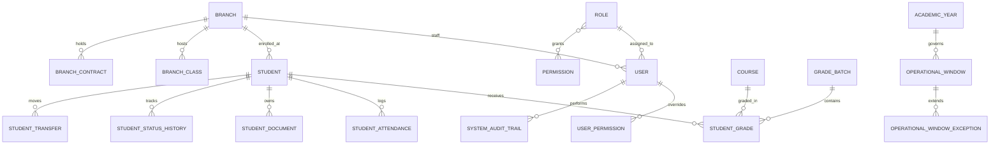

# الوصف المعماري الكامل لمنظومة «المعهد التخصصي للعلوم الشرعية» (IIIS Enterprise ERP)

> **تاريخ الإعداد:** 2026-10-17
> **الأساس:** قراءة مباشرة لملفات المستودع (الفرع `main` مع تعديلات غير مُلتزَمة في شجرة العمل). كل رقم أو اسم ملف مذكور هنا مأخوذ من الكود نفسه، وما لم يُتحقق منه صراحةً يُشار إليه.
> **الجمهور المقصود:** مطوّرون وفريق تقني يتسلّم المنظومة أو يعدّل فيها.
> **آخر تحديث:** 2026-10-27 بعد الحزمة الأمنية (نطاق مدير الفروع، مفتاح توقيع الوثائق، التحقق بخطوتين للإدارة العامة، تهيئة Redis). الحالة التفصيلية لكل متطلب ونتائج الاختبارات في القسم 20.

---

## 1. نظرة عامة

| البند | الوصف |
|---|---|
| الاسم | منظومة «المعهد التخصصي للعلوم الشرعية» المركزية (IIIS Enterprise ERP) |
| الغرض | إدارة الحوكمة الأكاديمية والإدارية لشبكة فروع المعهد: القبول والتسجيل، الحضور، المناهج، الرصد والامتحانات، الشهادات الموثّقة، النقل بين الفروع، الأصول والعقود |
| نمط التشغيل | نظام مركزي على الويب يربط **الإدارة العامة (HQ)** بـ**الفروع**، مع عزل بيانات الفروع وتقييد الصلاحيات حسب الدور |
| الواجهة | تطبيق صفحة واحدة (SPA) داخل قوالب Blade، مع إمكانية التثبيت كتطبيق PWA عبر `public/manifest.json` و`public/sw.js` |
| المستخدمون | المدير العام (`super_admin`)، أدوار الإدارة العامة (`hq_*`)، أدوار الفروع (`branch_*`)، مدرّس المادة (`course_instructor`) |

---

## 2. المكدس التقني

| الطبقة | التقنية | الإصدار / الملاحظة | المصدر |
|---|---|---|---|
| إطار العمل الخلفي | Laravel Framework | `v12.69.2` | `composer.lock` |
| لغة الخادم | PHP | `^8.2` | `composer.json` |
| قاعدة البيانات | SQLite افتراضياً | `DB_CONNECTION=sqlite` | `.env`، `config/database.php` |
| الجلسات والتخزين المؤقت والطوابير | قاعدة البيانات | `SESSION_DRIVER=database`، `CACHE_STORE=database`، `QUEUE_CONNECTION=database` | `.env` |
| الواجهة الأمامية | Blade + Alpine.js | مكتبة محلية في `public/js/alpine.min.js` | `resources/views/dashboard/` |
| التنسيق | Tailwind CSS | يُبنى عبر `tailwindcss` CLI إلى `public/css/app.css` | `package.json`، `resources/css/app.css` |
| أداة البناء | Vite 7 + `laravel-vite-plugin` | | `package.json`، `vite.config.js` |
| الخرائط | Leaflet.js | لعرض مواقع الفروع | قسم `branches_directory` |
| ملفات Excel | `shuchkin/simplexlsx` و`shuchkin/simplexlsxgen` | `1.1.19` و`1.5.17` | `composer.lock`، `app/Support/` |
| الاختبارات | PHPUnit | `^11.5.50` | `composer.json`، `phpunit.xml` |
| المصادقة الثنائية | TOTP مكتوب داخلياً | `app/Services/TotpService.php` | |

> **ملاحظة:** `package.json` يحتوي على `tailwindcss ^3.4.17` و`@tailwindcss/vite ^4.0.0` معاً. راجع القسم 18 (البند 2).

---

## 3. المخطط المعماري



### طبقات النظام

| الطبقة | المكان | الدور |
|---|---|---|
| نقطة الدخول | `public/index.php` | تحميل Laravel وتمرير الطلب |
| التهيئة | `bootstrap/app.php` | تسجيل المسارات، سلسلة الوسطاء، الأسماء المستعارة، معالجة الاستثناءات |
| المسارات | `routes/web.php`، `routes/api.php`، `routes/console.php` | الصفحات، واجهات JSON، المهام المجدولة |
| المتحكمات | `app/Http/Controllers/` (30 متحكم API + متحكمات المصادقة) | استقبال الطلب والتحقق منه وتفويض العمل |
| الخدمات | `app/Services/` (23 خدمة) | منطق الأعمال الحرج: الحساب، التدقيق، التشفير، سير العمل |
| النماذج | `app/Models/` (50 نموذجاً) | الكيانات وعلاقاتها وفلترة الفروع التلقائية |
| الوسطاء | `app/Http/Middleware/` (11 ملفاً) | الأمان، الصلاحيات، النوافذ الزمنية، الجلسات |
| الاستيراد والتصدير | `app/Support/` | مكتبات Excel |
| الهجرات والبذور | `database/migrations/` (53 ملفاً)، `database/seeders/` (6 ملفات) | بناء المخطط وبيانات أولية |

---

## 4. دورة حياة الطلب

1. يصل الطلب إلى `public/index.php` ثم `bootstrap/app.php`.
2. **وسطاء مجموعة `web`** (عامة لكل صفحة): `CompressResponse`، `SecurityHeadersMiddleware`، `SessionIdleTimeoutMiddleware`.
3. **وسطاء مجموعة `api`** بالترتيب: `RejectCrossSiteApiWrites`، ثم تهيئة الكوكيز والجلسة، ثم `CompressResponse`، و`SessionIdleTimeoutMiddleware`، و`SecurityHeadersMiddleware`.
4. **وسطاء المسار** (تُطبَّق حسب المسار):
   - `auth`: يجب أن يكون المستخدم مسجلاً.
   - `enforce.mfa`: فرض التحقق بخطوتين عند الحاجة.
   - `force.password_change`: إجبار تغيير كلمة المرور الأولى.
   - `throttle:60,1` على مسارات `v1` المحمية.
   - `permission:<code>`: فحص صلاحية محددة (يُستخدم في نحو 200 موضع في `routes/api.php`).
   - `academic.year.active`: التأكد من وجود عام دراسي فعّال (8 مواضع في `routes/api.php`).
   - `check.window:<TYPE>`: النافذة التشغيلية (موضع واحد في `routes/api.php`، ويُطبَّق في مواضع محددة).
   - `module.closed:<module>`: إغلاق وحدة كاملة (9 مواضع).
5. المتحكم يستدعي الخدمة، والخدمة تستعلم عبر النموذج. فلتر `BranchScope` يُضاف تلقائياً.
6. الرد JSON للـ API، أو صفحة Blade لبقية المسارات.
7. **الاستثناءات:** تُسجَّل عبر `SystemErrorMonitoringService::recordThrowable` دون أن تعطّل الرد. وانتهاء صلاحية رمز CSRF يعيد التوجيه إلى `/login` برسالة واضحة.

---

## 5. المصادقة والأمان

| الضابط | التنفيذ | الملف |
|---|---|---|
| قفل الدخول المتدرّج | 5 محاولات فاشلة ← قفل دقيقة، 8 ← 15 دقيقة، 12 ← 24 ساعة. يُطبَّق على الحساب وعلى عنوان IP معاً | `app/Services/LoginSecurityService.php` |
| التحقق بخطوتين (TOTP) | **معطّل افتراضياً بقرار المعهد.** يُفعَّل بمتغيرين: `MFA_ENFORCE_HQ=true` لإلزام `super_admin` وكل أدوار `hq_*`، و`MFA_ENABLED=true` لتوسيعه إلى بقية الأدوار ذات النطاق الشامل. عند التفعيل يُحوَّل الحساب إلى إعداد التحقق (`MFA_SETUP_REQUIRED`) ثم إلى التحدّي في كل جلسة (`MFA_CHALLENGE_REQUIRED`). يتضمن رموز استرداد (8 رموز) | `app/Models/User.php` (`requiresMfa`، `isHeadOfficeAccount`)، `app/Http/Middleware/EnforceMfaMiddleware.php`، `app/Services/TotpService.php` |
| إجبار تغيير كلمة المرور | يمنع الوصول إلى المسارات المحمية حتى يغيّر المستخدم كلمة المرور عند الحاجة | `ForcePasswordChangeMiddleware.php` |
| مهلة الخمول | 30 دقيقة بلا نشاط ← تسجيل خروج تلقائي | `SessionIdleTimeoutMiddleware.php` |
| منع الكتابة عبر المواقع | يرفض طلبات الكتابة (POST/PUT/DELETE) إذا كان `Sec-Fetch-Site` ليس `same-origin` أو كان `Origin` من نطاق آخر | `RejectCrossSiteApiWrites.php` |
| CSRF | مستثنى منه `api/*` و`logout`، لأن واجهة API محمية بالجلسة ومنع الكتابة عبر المواقع | `bootstrap/app.php` |
| رؤوس الأمان | رؤوس HTTP أمنية على صفحات الويب وAPI | `SecurityHeadersMiddleware.php` |
| الوكلاء الموثوقون | يُضبط بالمتغير `TRUSTED_PROXIES` لمنع انتحال عنوان IP | `bootstrap/app.php` |
| تحديد المعدل | عام: `throttle:30,1`. محمي: `throttle:60,1`. التحقق من الوثائق: `throttle:15,1` | `routes/api.php`، `routes/web.php` |
| سجل التدقيق | سجل جنائي لكل حدث حساس، بسلسلة تجزئة (hash chain) في الهجرات `2026_10_01_000003` و`2026_10_03_000001` | `app/Models/SystemAuditTrail.php` |
| محاولات الوصول غير المصرح بها | تُسجَّل كحدث `UNAUTHORIZED_ACCESS_ATTEMPT` مع المسار والصلاحية المطلوبة وعنوان IP | `CheckPermission.php` |
| الخزنة المشفّرة للملفات | ملفات الطلاب تُخزَّن مشفّرة بـ`Crypt::encrypt` في قرص محلي خاص، مع فحص مكافحة الفيروسات، وروابط موقّعة صالحة 30 دقيقة افتراضياً | `app/Services/SecureFileVaultService.php`، `AntivirusScanService.php` |
| توقيع الوثائق الرسمية | HMAC-SHA256 لكل وثيقة صادرة، والتحقق عبر رمز UUID عام. المفتاح من `DOCUMENT_SIGNATURE_KEY` (`config('app.document_signature_key')`) حصراً، ولا مفتاح احتياطي في الكود: غيابه يرمي `RuntimeException` ويوقف الإصدار والتحقق | `app/Services/DocumentLedgerService.php` |

---

## 6. الأدوار والصلاحيات وعزل الفروع

### 6.1 النموذج

- **المستخدم** (`User`): يرتبط بـ`branch_id` (فرعه) و`role_id` (دوره). وله صلاحيات مباشرة عبر جدول `user_permissions` (تجاوز فردي بقيمة `is_granted`).
- **الدور** (`Role`): له `scope_type` إما `GLOBAL_SCOPE` (إدارة عامة) أو نطاق فرع. ويرتبط بالمسمى الوظيفي (`JobPosition`) منذ الهجرة `2026_10_17_000001`.
- **الصلاحية** (`Permission`): رمز بصيغة `module.action` مثل `students.view` و`grades.approve_hq` و`students.submit_hq` و`backups.manage`.

### 6.2 ترتيب فحص الصلاحية

`User::hasPermission()` في `app/Models/User.php`:

1. المدير العام `super_admin` يجتاز كل فحص.
2. يدعم فحص عدة صلاحيات بصيغة OR عبر `|` أو `,`.
3. **التجاوز الفردي أولاً:** إذا وُجد سجل مباشر للمستخدم بهذه الصلاحية، تُعتمد قيمة `is_granted`.
4. وإلا تُفحص صلاحيات الدور.

### 6.3 النطاق (Scope)

- `User::isHQ()` = مدير عام أو دور بنطاق `GLOBAL_SCOPE`.
- `User::hasGlobalAccessScope()` = `isHQ()`.
- **عزل الفروع التلقائي:** النماذج التي تستخدم السمة `BelongsToBranch` (12 نموذجاً) تضيف `BranchScope` تلقائياً. مستخدم الفرع يرى سجلات فرعه فقط. وعند الإنشاء يُعيَّن `branch_id` تلقائياً من فرع المستخدم.
- **سياسات الوصول (Policies):** 6 سياسات في `app/Policies/` (الطلاب، الفروع، العقود، الدرجات، وثائق الطلاب، النقل).

### 6.4 الأدوار المعرّفة في الهجرات والبذور

| المجموعة | أمثلة |
|---|---|
| المدير العام | `super_admin` |
| الإدارة العامة (`hq_*`) | `hq_director_office`، `hq_student_affairs`، `hq_exams_director`، `hq_curriculum_office`، `hq_it_office`، `hq_internal_auditor`، `hq_admin_financial`، `hq_legal_office`… |
| الفروع (`branch_*`) — `BRANCH_SCOPE` | `branch_manager`، `branch_registrar`، `branch_exams_officer`، `branch_admin_fin`، `branch_social_worker`، ومعها `course_instructor`: كلها مقيّدة بفرع المستخدم (`branch_id`) |
| إدارة الفروع — `GLOBAL_SCOPE` | `branches_director`: إشراف على كل الفروع، فنطاقه الإدارة العامة وليس فرعاً. تثبّته الهجرة `2026_10_27_000001_enforce_role_scopes` في قواعد البيانات القائمة |

---

## 7. النوافذ التشغيلية (Operational Windows)

العمليات الحساسة مقيّدة بنافذة زمنية تحددها الإدارة العامة لكل عام دراسي:

| النوع (`window_type`) | الاستخدام |
|---|---|
| `REGISTRATION` | التسجيل والقبول |
| `S1_COURSEWORK` | أعمال السنة للفصل الأول |
| `S1_FINAL` | امتحان نهاية الفصل الأول |
| `S2_FINAL` | الامتحان النهائي للفصل الثاني |
| `SECOND_ROUND` | الدور الثاني |

**منطق الفتح** (`OperationalWindow::isOpenForBranch`):
- النافذة يجب أن تكون `is_active = true`.
- الوقت الحالي ضمن `start_at` و`end_at`.
- إن انتهت النافذة، يُسمح للفرع إذا كان لديه استثناء تمديد معتمد (`OperationalWindowException` بتاريخ `extended_until` لاحق للوقت الحالي).

**تجاوز المدير العام:** يتجاوز `super_admin` النافذة كلها لأغراض الإصلاح الطارئ.

> **تم إصلاحه (البند «أ» في القسم 18.2):** `CheckOperationalWindow` لم يعد ينشئ نافذة. النافذة المفقودة تُرفض بالحالة `NOT_CONFIGURED`، والمعطّلة تُرفض بالحالة `DISABLED`، ولا تُستبدل أيٌّ منهما. تُهيَّأ النوافذ الناقصة مغلقةً فقط بالأمر `windows:initialize-missing`.

---

## 8. الوحدات المغلقة (Shielded / Closed Modules)

| الآلية | التنفيذ | الأثر |
|---|---|---|
| قائمة الوحدات المغلقة | `ModuleStateController::CLOSED_MODULES = ['study_and_exams', 'grading', 'transcripts', 'batch_print']` | تُرجع `423 MODULE_CLOSED` لجميع المستخدمين عبر `module.closed`، بمن فيهم المدير العام |
| الدرع البرمجي | `ShieldedFeatureMiddleware` | يرجع `423` خارج بيئتي `local` و`testing`، إلا بإرسال رأس `X-Bypass-Shield` يطابق `app.dev_bypass_secret` |
| مفاتيح الوحدات القابلة للتبديل | `TOGGLEABLE_MODULES` مع `DEFAULT_LOCKED` في `ModuleStateController` | يعرض حالة كل وحدة في واجهة الإعدادات |

**الخلاصة:** الوحدات الأربع (الدراسة والامتحانات، الدرجات، الشهادات، الطباعة والتصدير) **مغلقة ومجدولة لمرحلة إطلاق تالية بعد اكتمال محرك إعادة السنة والسنة الاستثنائية**. تعيد كل مساراتها `423 MODULE_CLOSED` لجميع الأدوار بمن فيهم المدير العام، ومحاولة تبديلها من الواجهة تُرفض بالرمز نفسه. فتحها قرار موثّق يتطلب تعديل الثابت `CLOSED_MODULES` في الكود.

---

## 9. الوحدات الوظيفية والشاشات

تُحمَّل الشاشات من `resources/views/dashboard/index.blade.php` بالترتيب التالي (29 قسماً في `dashboard/sections/`):

| المجموعة | الشاشة (`section`) | الوظيفة | المتحكم الرئيسي |
|---|---|---|---|
| القيادة | `dashboard` | لوحة المؤشرات العامة للإدارة | `HQDashboardController` |
| القيادة | `procedures` | دليل الإجراءات (واجهة إرشادية) | — |
| القيادة | `matrix` | مصفوفة الصلاحيات (للنطاق الشامل فقط) | `PermissionMatrixController` |
| شؤون الطلاب | `students` | السجل العام، القبول، الاستيراد الدفعي، الطباعة | `StudentController`، `StudentRegistryReportController` |
| شؤون الطلاب | `student_file` | الملف الشامل 360° للطالب: الجدول الزمني، الملاحظات، السلوك، الوثائق، الحالة | `StudentFileController` |
| شؤون الطلاب | `student_workflow` | مركز طلبات الفروع: تجميد، نقل، إعادة قيد، مراجعة درجات، تعديل بيانات | `StudentWorkflowController` |
| شؤون الطلاب | `excuses` | الأعذار الرسمية والمراجعة والاعتماد | `StudentFileController` |
| الحضور | `attendance` | الحضور والانصراف، المسح بـQR، أذونات الخروج، إنذارات الغياب | `StudentAttendanceController` |
| الدراسة والامتحانات | `study_and_exams` | مغلقة حالياً (القسم 8) | `StudyAndExamsController` |
| الدرجات | `grading` | رصد سريع للدرجات، دفعات، اعتماد، أرشفة | `FastGradeEntryController`، `ExamApprovalController` |
| الشهادات | `transcripts` | كشوف الدرجات والشهادات والتحقق | `TranscriptEngineController` (مغلقة حالياً) |
| الطباعة | `batch_print` | الطباعة الجماعية والتصدير (مغلقة حالياً) | — |
| الهيكل الأكاديمي | `academic_structure` | الأقسام والشعب والمراحل | `AcademicStructureController` |
| المناهج | `curriculum` | المقررات والخطة الدراسية والساعات المعتمدة | `CourseController` |
| الفروع | `branches_directory` | دليل الفروع وخريطة Leaflet وتقييم الجاهزية | `BranchOperationsController` |
| الفروع | `branch_requests` | طلبات الصيانة والتشغيل | `BranchOperationsController` |
| الفروع | `branch_contracts` | عقود المقرات وحساب الانتهاء والإيجارات | `PropertyContractController` |
| الاعتمادات | `approvals` | قائمة الاعتمادات المعلّقة بمختلف أنواعها | متحكمات متعددة حسب نوع الاعتماد |
| الجودة | `data_quality` | نواقص الملفات (صورة، رقم وطني، هاتف ولي أمر، شهادات) | `StudentDataQualityController` |
| الرقابة | `audit` | سجل التدقيق | `AuditLogController` |
| الرقابة | `error_monitoring` | الأخطاء غير المحلولة | `SystemErrorMonitoringController` |
| الإدارة | `users` | الحسابات والأدوار والصلاحيات المباشرة | `UserController`، `PermissionMatrixController` |
| الإدارة | `admin_settings` | هوية المعهد والتوقيعات والنسخ الاحتياطية | `AdminSettingsController`، `BackupController` |
| الإدارة | `org_structure` | الهيكل التنظيمي، المسميات، التسكين | `AdminSettingsController` |
| الإدارة | `settings` | التقويم، الأعوام الدراسية، النوافذ، الترحيل | `SettingsController` |
| الإدارة | `themes` | تبديل ثيمات الألوان | واجهة أمامية |
| التحديثات | `updates` | سجل تغييرات النظام | `SystemChangelogController` |
| الدعم | `bug_reports` | بلاغات الأخطاء مع تشخيص المتصفح | `BugReportController` |
| الحساب | `profile` | ملف المستخدم الشخصي | `UserProfileController` |

> الشاشات الخاصة بالنطاق الشامل تُخفى في القالب عبر `hasGlobalAccessScope()`، لكن **الحماية الفعلية تبقى في الـAPI** عبر وسيط `permission`. إخفاء الواجهة وحده لا يكفي.

---

## 10. آلات الحالة وسير العمل

### 10.1 حالات الطالب (`StudentStateMachineService::STATE_TRANSITIONS`)

| الحالة | الانتقالات المسموحة |
|---|---|
| `NEW_DRAFT` | مسودة قبل الإرسال إلى الإدارة |
| `PENDING_HQ` | بانتظار اعتماد الإدارة العامة |
| `REJECTED_REVISION` | مرفوض ويحتاج تعديلاً |
| `ENROLLED_ACTIVE` | قيد نشط |
| `SUSPENDED` | موقوف القيد |
| `TRANSFERRED` | **حالة نهائية:** منقول إلى فرع آخر |
| `GRADUATED` | **حالة نهائية:** متخرج |
| `EXPELLED` | **حالة نهائية:** مفصول |

### 10.2 مراحل النقل بين الفروع (`StudentTransferWorkflow`)

`ORIGIN_BRANCH_REQUESTED` ← طلب الفرع المصدِّر
← `ACADEMIC_AFFAIRS_REVIEWED` ← مراجعة الشؤون الأكاديمية
← `DESTINATION_BRANCH_ACCEPTED` ← قبول الفرع المستقبِل
← `HQ_FINAL_APPROVED` ← الاعتماد النهائي من الإدارة العامة

ويمكن الرفض (`REJECTED`) من أي مرحلة قبل الاعتماد النهائي.

### 10.3 دفعات الدرجات (`grade_batches.status`)

| الحالة | المعنى |
|---|---|
| `DRAFT` | مسودة قيد الرصد |
| `SUBMITTED_TO_HQ` | مرفوعة للكنترول المركزي |
| `HQ_REJECTED` | مرفوضة من الكنترول، تعود للتعديل |
| `HQ_APPROVED` | معتمدة من الكنترول |
| `FINAL_ARCHIVED` | مؤرشفة نهائياً ومقفلة |

نوع الامتحان: `REGULAR` أو `SECOND_ROUND`. ونتيجة الطالب: `PASS` أو `FAIL` أو `RESIT` أو `ABSENT` أو `EXEMPTED`. وتعديلات الدرجات بعد الاعتماد تُسجَّل في `GradeLog` عبر `ForensicGradeLoggerService`.

---

## 11. نموذج البيانات

### 11.1 المجموعات الرئيسية (50 نموذجاً)

| المجموعة | النماذج |
|---|---|
| الأكاديمية | `AcademicYear`، `AcademicYearRolloverLog`، `StudyYear`، `Department`، `Course`، `BranchClass` |
| الطلاب | `Student`، `StudentDocument`، `StudentStatusHistory`، `StudentNote`، `StudentBehavior`، `ExcuseRequest`، `StudyTypeChangeRequest`، `StudentTransfer`، `EnrollmentStatusRequest` |
| الدرجات | `StudentGrade`، `GradeBatch`، `GradeLog` |
| الحضور | `StudentAttendance`، `AttendanceWarningNotice`، `OfflineSyncLog` |
| الفروع والأصول | `Branch`، `BranchFacility`، `BranchAssessment`، `BranchRequest`، `BranchRequestTracking`، `BranchContract`، `ContractInstallment`، `Property`، `InventoryItem`، `InventoryTransaction` |
| الحوكمة | `OrganizationalUnit`، `JobPosition`، `EmployeePlacement`، `OfficialDocumentSignatory`، `RequestDiscussion` |
| الوقت والنوافذ | `OperationalWindow`، `OperationalWindowException` |
| الاعتماد الرسمي للاستثناءات | `AdministrativeRequest` (طلب يقدمه الفرع)، `AdministrativeDecision` (قرار برقم فريد مرتبط بالطلب) |
| الأمان والمستخدمون | `User`، `Role`، `Permission`، `AdministrativeSetting`، `DocumentVerification` |
| التدقيق والنظام | `SystemAuditTrail`، `SystemErrorLog`، `BackupLedger`، `BugReport`، `SystemChangelog` |

### 11.2 العلاقات الرئيسية (مختصرة)



### 11.3 ملاحظات على البيانات

- **الرقم الأكاديمي:** يُولَّد بواسطة `AcademicNumberGeneratorService` داخل معاملة قاعدة بيانات: رمز السنة (منزلتان) + بادئة + تسلسل من 4 منازل، لمنع التكرار بين الفروع المتزامنة.
- **التدقيق:** `system_audit_trails` محمي بسلسلة تجزئة. أي تعديل في سجل سابق يكسر السلسلة، وذلك ما تفحصه اختبارات `AuditVerificationDeepInspectionTest`.
- **البذور:** `AcademicSystemSeeder` (المقررات والهيكل)، `AdminSettingsSeeder`، `BranchesIntegrationSeeder`، `RealBranchPropertiesAndContractsSeeder`، `SystemChangelogSeeder`، و`DatabaseSeeder` الذي ينسّقها.

---

## 12. الخدمات (`app/Services/`)

| الخدمة | الدور |
|---|---|
| `AcademicNumberGeneratorService` | توليد الرقم الأكاديمي للطالب بشكل ذرّي |
| `AdminSettingsService` | الإعدادات المركزية: هوية المعهد، التوقيعات الرسمية، الكاش، سجل تغييرات الإعدادات |
| `AbsenceCalculationEngineService` | حساب نسب الغياب وإنذارات الحرمان (5%، 10%، 15%) |
| `GradeCalculationEngineService` | حساب درجات المقررات والنتائج |
| `LibyanOfficialGradingEngine` | نظام التقدير الرسمي المعتمد |
| `ForensicGradeLoggerService` | تسجيل تعديلات الدرجات بعد الاعتماد |
| `StudentStateMachineService` | قواعد انتقال حالة الطالب (القسم 10.1) |
| `StudentTransferWorkflow` | دورة نقل الطالب بين الفروع (القسم 10.2) |
| `StudentDocumentService` | رفع وإدارة وثائق الطلاب |
| `SecureFileVaultService` | تخزين الملفات مشفّرة وفك تشفيرها وروابط موقّعة |
| `AntivirusScanService` | فحص الملفات المرفوعة قبل تخزينها |
| `DocumentLedgerService` | إصدار الوثائق الرسمية والتحقق منها (HMAC-SHA256) |
| `EnterpriseBackupService` | النسخ الاحتياطي المشفّر (القسم 13.4) |
| `LoginSecurityService` | قفل الدخول المتدرّج (القسم 5) |
| `TotpService` | توليد وتحقق رموز TOTP ورموز الاسترداد |
| `OfflineAttendanceSyncService` | مزامنة الحضور المُسجَّل دون اتصال |
| `BranchStaffService` | تسكين الموظفين في الفروع والوظائف |
| `ContractFinancialEngineService` | الحساب المالي لعقود المقرات والأقساط |
| `StudyYearDeletionService` | حذف عام دراسي بقواعد حماية |
| `SystemErrorMonitoringService` | تسجيل الاستثناءات وأخطاء الواجهة |
| `MetricsCacheService` | تخزين ملخص مؤشرات الإدارة العامة مؤقتاً (`Cache::remember`) مع إبطال الكاش عند التغيير |
| `AdmissionRulesService` | قواعد القبول بحسب العمر (صفة القيد والجنس والمدينة والتاريخ المرجعي)، محفوظة في الإعدادات المركزية `admission_age_rules`، ويطبقها `AdmissionAgeRule` في الخادم وواجهة التسجيل والاستيراد |
| `AdministrativeRequestService` | مسار الاعتماد الرسمي: تقديم الطلب من الفرع، والقرار من الإدارة العامة برقم فريد، واستهلاك الطلب المعتمد مرة واحدة داخل معاملة القيد |

---

## 13. المهام المجدولة والخلفية

### 13.1 المهام اليومية (`routes/console.php`)

| الوقت | الأمر | الغرض |
|---|---|---|
| 02:00 | `iiis:backup-run --type=scheduled` | نسخة احتياطية مشفّرة يومية، وتنبيه حرج عند الفشل |
| 06:00 | `contracts:monitor-expirations --days=30` | رصد عقود المقرات التي تنتهي خلال 30 يوماً |
| 07:00 | `branches:audit-contract-compliance` | تدقيق تجاوز مهلة السماح في الفروع |
| 15:00 | `attendance:monitor-absence-thresholds` | حساب نسب الحرمان وتطبيق قفل التعديل بأثر رجعي |

جميع المهام تعمل بـ`withoutOverlapping()` و`runInBackground()`.

### 13.2 أوامر Artisan المخصّصة (9 أوامر)

- `iiis:backup-run`، `iiis:backup-restore`، `backup:enterprise-snapshot --verify`
- `app:admin-credentials`: إنشاء أو إعادة تعيين بيانات مدير، مع خيار تعطيل TOTP
- `attendance:monitor-absence-thresholds`، `contracts:monitor-expirations`، `branches:audit-contract-compliance`
- `app:prepare-production-launch`، `app:reset-branches`: أوامر **مدمّرة** تُحمى بـ`GuardsDestructiveRuns` وتتطلب تأكيداً تفاعلياً ورفعاً صريحاً لوضع الإنتاج

### 13.3 الطوابير

- الطوابير افتراضياً من نوع `database` (الملف الشخصي A). للحمل المتزامن من عدة فروع يُنصح بالملف الشخصي B: Redis بقواعد منفصلة (الكاش `REDIS_CACHE_DB=1`، الجلسات `REDIS_SESSION_DB=2`، الطوابير `REDIS_QUEUE_DB=3`) كما في `.env.example` و`config/database.php`. الوظيفتان في `app/Jobs/`: `ExecuteBackupJob` و`ProcessOfflineAuditSyncJob`.
- يجب تشغيل عامل الطابور (`php artisan queue:listen`) ليعمل ما يُرسَل إليه.

### 13.4 النسخ الاحتياطي (`EnterpriseBackupService`)

1. تفريغ قاعدة البيانات إلى ملف مؤقت.
2. إنشاء بيان تشفير (Manifest) يحتوي على التجزئات.
3. ضغط الحمولة في ملف ZIP (`ZipArchive`).
4. تشفير الملف بـ`AES-256-CBC`.
5. تسجيل النسخة في `backups_ledger` (`BackupLedger`) وتدويرها.

---

## 14. الواجهة الأمامية

- **نقطة الدخول:** `resources/views/dashboard/index.blade.php` (وهي المستخدمة فعلياً من `routes/web.php` عبر `view('dashboard.index')`).
- **الأقسام:** كل شاشة ملف مستقل في `dashboard/sections/` يُضمَّن عبر `@include`. الحاوية `<main>` تعرض القسم الحالي بناءً على `currentSection`.
- **منطق الحالة:** دالة `academicApp()` في `resources/views/dashboard/modals/scripts.blade.php` (Alpine.js). تحمّل بيانات كل قسم عند فتحه.
- **الوضع الليلي:** متغير `darkMode` على عنصر `<html>` عبر `:class`.
- **الثيمات:** تُبدَّل من شاشة الثيمات. ويُطبَّق اللون عبر الصنف `theme-*` على `<body>`.
- **الطباعة المعزولة:** دالة `printCustomHtmlElement` تطبع عنصراً في إطار (iframe) منفصل كي لا تظهر عناصر الواجهة في المستند المطبوع.
- **الحضور دون اتصال:** `public/js/offline-attendance.js` يخزّن سجلات الحضور في IndexedDB، ثم يرفعها عبر `POST /api/v1/attendance/sync` إلى `OfflineAttendanceSyncService`.
- **تشخيص المتصفح:** مسجّل في بداية الصفحة يلتقط أخطاء `console` والأخطاء غير المعالجة والطلبات الفاشلة، ويُرفق مع بلاغات الأخطاء.
- **PWA:** `public/sw.js` بذاكرة مؤقتة باسم `iiis-academic-v1.4` و`public/manifest.json`.
- **صفحات قديمة:** مسارات مثل `/settings.php` و`/edit_course.php` و`/branches.php` تُعيد التوجيه إلى الأقسام الجديدة داخل `/?section=...`.

---

## 15. المسارات

### 15.1 `routes/web.php`

| المجموعة | المسارات |
|---|---|
| ضيف فقط (`guest`) | `GET/POST /login` |
| عام | `GET/POST /logout` |
| مصادقة فقط | `/mfa/setup`، `/mfa/confirm`، `/mfa/challenge`، `/mfa/verify`، `/password/change`، `/password/update` |
| محمي (`auth` + `enforce.mfa` + `force.password_change`) | `/` (لوحة النظام)، وتحويلات الصفحات القديمة |
| عام بدون مصادقة | `GET /verify/{uuid}` بحد 15 طلباً في الدقيقة للتحقق من وثيقة رسمية |

### 15.2 `routes/api.php`

- **المجموعة العامة:** `/api/v1/...` بحد 30 طلباً في الدقيقة. تشمل التحقق من الوثائق، واستقبال أخطاء الواجهة، وقوالب الاستيراد.
- **المجموعة المحمية:** `/api/v1/...` بالوسطاء `auth` و`enforce.mfa` و`force.password_change` وحد 60 طلباً في الدقيقة. وتحتوي على 219 تعريف مسار تقريباً، موزعة على 28 متحكماً.
- **البادئات الفرعية:** `attendance`، `students/{student}/file`، `admin/settings`، `academic-structure`، `system-errors`، `backups`.
- **مسارات أُضيفت للاعتماد الرسمي (2026-10-17):** `students/registry/official` (السجل الرسمي للطباعة مع التوقيعات المركزية، بحد 500 طالب)، و`admin-requests` (تقديم الطلب بصلاحية `students.create`، وقرار الاعتماد بصلاحية `students.approve_hq` للإدارة العامة فقط)، و`admin/settings/admission-rules` (القراءة بصلاحية الإعدادات، والحفظ بصلاحية `admin_settings.manage`).
- **أكثر المتحكمات استخداماً في المسارات:** `SettingsController` (30)، و`StudentFileController` (24)، و`BranchOperationsController` (23)، و`PropertyContractController` (18)، و`StudentController` (16)، و`StudentAttendanceController` (14).

---

## 16. الإعدادات والنشر

### 16.1 متغيرات البيئة المهمة (`.env`)

| المتغير | الغرض | الحالة في `.env` الحالي |
|---|---|---|
| `APP_KEY` | مفتاح التشفير والتوقيع | مضبوط |
| `DB_CONNECTION` | نوع قاعدة البيانات | `sqlite` |
| `SESSION_DRIVER` / `CACHE_STORE` / `QUEUE_CONNECTION` | الجلسات والكاش والطوابير | `database` |
| `MFA_ENFORCE_HQ` | إلزام التحقق بخطوتين لـ `super_admin` وأدوار `hq_*` | الافتراضي `false` (معطّل) |
| `MFA_ENABLED` | توسيع الإلزام إلى بقية الأدوار ذات النطاق الشامل | غير مضبوط، والافتراضي `false` |
| `DOCUMENT_SIGNATURE_KEY` | مفتاح HMAC لتوقيع الوثائق الرسمية. **إلزامي** | يجب تعريفه في كل بيئة (راجع ملاحظة الترقية في 18.1) |
| `TRUSTED_PROXIES` | الوكلاء الموثوقون عند وجود Reverse Proxy | |
| `MAIL_*`، `REDIS_*`، `AWS_*` | البريد والتخزين السحابي والكاش الموزّع | حسب البيئة |

### 16.2 التثبيت

```bash
composer install
php artisan key:generate
php artisan migrate --force
npm install
npm run build
```

(الأوامر مجمّعة في سكربت `setup` داخل `composer.json`.)

### 16.3 النشر

- `deploy.php`: سكربت نشر تفاعلي يسحب الكود من Git، ويشغّل Composer والهجرات، ويمسح الكاش، ويسجّل في سجل التغييرات.
- `deploy.bat`: يستدعي `deploy.ps1`. أُعيد `deploy.ps1` إلى شجرة العمل من `HEAD` في 2026-10-17 (راجع البند «ب» في القسم 18.2).

---

## 17. الاختبارات

- الإعداد في `phpunit.xml`، والاختبارات في `tests/Feature/` (ملفات كثيرة تغطي العزل بين الفروع، والـRBAC، والمصادقة الثنائية، والنسخ الاحتياطي، والدرجات، والنوافذ التشغيلية، والتحقق من الوثائق).
- التشغيل: `php artisan test`، أو `composer test` الذي يمسح الكاش أولاً.

---

## 18. الملاحظات والمخاطر

مقسّمة إلى بنود قائمة (مرقّمة تسلسلياً من الأعلى أثراً إلى الأقل)، وبنود أُغلقت (محفوظة بحروف لتُتتبَّع). وكل بند مبني على الكود المذكور.

### 18.1 بنود قائمة

1. **حمل الكتابة المتزامنة على قاعدة البيانات.** الإعداد الافتراضي يضع الجلسات والكاش والطوابير في قاعدة البيانات نفسها (SQLite محلياً، MySQL في `.env.example`). هيّأنا ملفاً شخصياً بديلاً بـ Redis في قواعد منفصلة (قسم 13.3 و`.env.example`) وجُرِّب على Redis 7 محلي بالعميل `predis`: الكاش في القاعدة 1 والجلسات في القاعدة 2 والطوابير في القاعدة 3، وتسجيل الدخول والتشغيل الفعلي لمهمة طابور نجحا. هو غير مفعّل افتراضياً ولم يُجرَّب على الخادم الحي. المطلوب قبل التشغيل الكامل: تقييم الحمل الفعلي وتفعيل الملف الشخصي B إن لزم.
2. **تعارض إصدارات Tailwind.** `package.json` يحتوي `tailwindcss ^3.4.17` و`@tailwindcss/vite ^4.0.0` معاً، بينما يُبنى CSS عبر CLI الإصدار 3. يُنصح بتوحيد الإصدار.
3. **ملف Blade قديم مكرر.** `resources/views/dashboard.blade.php` نسخة قديمة من `dashboard/index.blade.php` ولا يستخدمه أي مسار. يُنصح بحذفه بعد التأكد.
4. **ملفات PHP قديمة وسكربتات تطوير.** `public/settings.php` و`public/edit_course.php` ومجلد `scratch/` (95 ملفاً بين سكربتات تجريبية وتقارير مؤقتة وملفات HTML قديمة). لا يجب أن تكون داخل المستودع المنشور.
5. **إعادة السنة والسنة الاستثنائية غير منفّذتين.** لا يوجد سجل أكاديمي لهاتين الحالتين (يذكر `Student::ENROLLMENT_STATUS_LABELS` ذلك صراحةً)، ولم تُحدَّد قيودهما في الكود. وهو شرط إطلاق الوحدات المغلقة (البند 7).
6. **رقم طلب اعتماد واحد لكل قيد.** نموذج التسجيل يقبل `admission_request_id` واحداً. إن احتاج الطالب استثناءين معاً (شرط العمر والتسجيل في صف مقيّد) فلا يكفي رقم واحد، ويُرفض القيد.
7. **الوحدات الأربع مغلقة.** الدراسة والامتحانات، الدرجات، الشهادات والوثائق، الطباعة والتصدير: **مغلقة ومجدولة لمرحلة إطلاق تالية بعد اكتمال محرك إعادة السنة والسنة الاستثنائية**. مساراتها تعيد `423 MODULE_CLOSED` لجميع الأدوار (القسم 8). ولذلك لم يُختبر قالب كشف الدرجات في متصفح؛ اختُبر توقيعه عبر المتحكم مباشرة (`OfficialSignatoriesCentralTest`)، وتُتخطى اختبارات الدرجات الثلاثة.
8. **اختبار الخزنة يتأثر ببرنامج الحماية المحلي.** `SecurityPhaseOneComprehensiveTest` كان يفشل على Windows بخطأ `Failed to open stream: Invalid argument` عند قراءة ملف يحوي نمط webshell. السبب المرجّح حجب القراءة من برنامج الحماية المحلي، ولم يُتحقق منه من سجل الحماية. الاختبار يستخدم الآن علامة `<?php` فقط، ومنطق الرفض المختبَر لم يتغير.
9. **الوثيقة السابقة متقادمة.** `docs/SYSTEM_COMPREHENSIVE_BLUEPRINT_FOR_PROMPTS.md` كُتبت قبل الإصدارات 2.5.x وتصف الوحدات الأربع كأنها مفتوحة. هذه الوثيقة هي المرجع الأدق حتى تُحدَّث تلك.

**ملاحظة ترقية (الإصدار 2.5.8):** لم يعد للتوقيع مفتاح احتياطي. إن وُقِّعت وثائق سابقاً بمفتاح `APP_KEY` فلا بد من ضبط `DOCUMENT_SIGNATURE_KEY` على قيمة `APP_KEY` الحالية عند الترقية، وإلا فشل إصدار الوثائق والتحقق منها. تدوير المفتاح بعد ذلك يُبطل التحقق من الوثائق المصدرة بالمفتاح القديم.

### 18.2 بنود أُغلقت

- **(أ) النافذة التشغيلية لا تُعاد فتحها تلقائياً.** `CheckOperationalWindow` يرفض الطلب إن غابت النافذة أو عُطّلت ولا ينشئ بديلاً. يبقى تجاوز المدير العام للطوارئ، وكل تجاوز يغيّر البيانات يُسجَّل في سجل التدقيق. الاختبارات: `OperationalWindowGovernanceTest`.
- **(ب) سكربت النشر.** أُعيد `deploy.ps1` من `HEAD` في 2026-10-17 فيعمل `composer run deploy` و`deploy.bat`.
- **(ج) التحقق بخطوتين للإدارة العامة.** مدعوم برمجياً لـ `super_admin` وكل أدوار `hq_*` بمتغير `MFA_ENFORCE_HQ`، لكنه **معطّل** بقرار المعهد (2026-10-27). تفعيله لاحقاً لا يحتاج تعديل كود (قسم 5).
- **(د) المفتاح الاحتياطي الثابت للتوقيع.** حُذف من `DocumentLedgerService`، والمفتاح من البيئة حصراً.
- **(هـ) نطاق مدير الفروع.** `branches_director` بنطاق `GLOBAL_SCOPE`، وأدوار `branch_*` و`course_instructor` بنطاق `BRANCH_SCOPE` (قسم 6.4)، تثبّتهما هجرة.
- **(و) الختم الرسمي المعتمد أُزيل من النظام بالكلية.** لا رفع في الإعدادات، ولا مفتاح في خانات التوقيع، ولا يُطبع على أي مستند. تحذف الهجرة `2026_10_27_000002_remove_official_stamp` إعداده وصورته. أما خانات «التوقيع والختم» الفارغة في المطبوعات فبقيت مساحة للختم اليدوي. والختم الرقمي (رمز QR وتوقيع HMAC) قائم.

---

## 19. الملفات المرجعية الرئيسية

| الغرض | الملف |
|---|---|
| تهيئة التطبيق والوسطاء | `bootstrap/app.php` |
| مسارات الويب | `routes/web.php` |
| مسارات API | `routes/api.php` |
| المهام المجدولة | `routes/console.php` |
| نموذج المستخدم والصلاحيات | `app/Models/User.php` |
| عزل الفروع | `app/Models/Scopes/BranchScope.php`، `app/Models/Traits/BelongsToBranch.php` |
| فحص الصلاحية | `app/Http/Middleware/CheckPermission.php` |
| النوافذ التشغيلية | `app/Http/Middleware/CheckOperationalWindow.php`، `app/Models/OperationalWindow.php` |
| الوحدات المغلقة | `app/Http/Controllers/Api/ModuleStateController.php` |
| قفل الدخول | `app/Services/LoginSecurityService.php` |
| الواجهة الرئيسية | `resources/views/dashboard/index.blade.php` |
| منطق Alpine.js | `resources/views/dashboard/modals/scripts.blade.php` |
| إعدادات الإدارة | `app/Services/AdminSettingsService.php` |
| النسخ الاحتياطي | `app/Services/EnterpriseBackupService.php` |
| التحقق من الوثائق | `app/Services/DocumentLedgerService.php` |
| قواعد القبول بحسب العمر | `app/Services/AdmissionRulesService.php`، `app/Rules/AdmissionAgeRule.php`، `app/Http/Controllers/Api/AdmissionRulesController.php` |
| الاعتماد الرسمي للاستثناءات | `app/Services/AdministrativeRequestService.php`، `app/Http/Controllers/Api/AdministrativeRequestController.php`، `database/migrations/2026_10_18_000002_*` |
| الهوية والجنسية والتفرد | `app/Http/Controllers/Api/StudentController.php` (`validatedIdentity`)، `database/migrations/2026_10_18_000001_*` |
| المستندات الإلزامية | `app/Services/StudentDocumentService.php` (`requiredTypesFor`، `missingRequiredTypes`) |
| السجل الرسمي للطباعة | `app/Http/Controllers/Api/StudentRegistryReportController.php` (`officialRegistry`)، `resources/views/dashboard/sections/students.blade.php` |

---

## 20. حالة متطلبات التسليم (2026-10-17)

**نتيجة `php artisan test` بعد التنفيذ: 199 ناجحاً، 3 متخطّاة، 0 إخفاق.** الاختبارات المتخطّاة هي اختبارات الدرجات، وتُتخطى لأن وحدة الدرجات مغلقة من الخادم (القسم 8)، لا لعيب في الاختبار. الإخفاق الوحيد قبل التنفيذ (الخزنة) عُولج كما في البند 8.

**ترحيلات قاعدة التطوير المحلية:** طُبّقت `2026_10_18_000001` و`2026_10_18_000002` بعد نسخة احتياطية، ولم تكن هناك هويات مكررة تمنع الفهارس الفريدة.

| # | المتطلب | الحالة | الدليل أو الفجوة |
|---|---|---|---|
| 1 | الإعدادات المركزية مصدر المسميات والحقول وقواعد القبول | مُنفّذ | `AdminSettingsService::getSignatoriesFor`، و`AdmissionRulesService`. الاختبارات: `RoleTitleAndStaffCountTest`، `AdmissionRulesAndIdentityTest` |
| 2 | النماذج الرسمية تقرأ أسماء الموقّعين وصفاتهم من الإعدادات المركزية | مُنفّذ | النماذج السبعة تأخذ الموقّعين من الخادم مع كل مستند. الواجهة تستخدم القيم التي أعادها الخادم، ولا تعتمد على `adminSettings` الذي لا يُحمَّل إلا لمن يملك صلاحية الإعدادات. الاختبار: `OfficialSignatoriesCentralTest` |
| 3 | كشف الحضور والغياب اليومي يعمل في الطباعة الفعلية | مُنفّذ جزئياً | تذييل الكشف صار من الإعدادات، والبيانات من `GET /attendance/reports`، والطباعة تنسخ العنصر المعروض. لم تُجرَ الطباعة في متصفح فعلي. |
| 4 | النماذج التي تحتوي توقيعاً حُصرت واختُبرت | مُنفّذ | سبعة نماذج: شهادة القيد، شهادة السلوك، التقرير السري، كشف الدرجات، إنذار الغياب، كشف الحضور اليومي، السجل الرسمي. لكل منها اختبار. كشف الدرجات يُختبر عبر المتحكم مباشرة لأن وحدته مغلقة. |
| 5 | المسميات الوظيفية مرتبطة بمصفوفة الصلاحيات | مُنفّذ | الهجرة `2026_10_17_000001`، واسم الدور هو المسمى الوظيفي. الاختبار: `RoleTitleAndStaffCountTest` |
| 6 | إنشاء المستخدم وتعديل حسابه يعتمدان المسميات المعتمدة | مُنفّذ | `UserController` يقبل المسمى النشط فقط (`Rule::exists(...)->where('is_active', true)`). |
| 7 | مصفوفة الصلاحيات تدعم التمرير الأفقي | مُنفّذ في الكود | `matrix.blade.php`: مربعات الأدوار داخل حاوية `overflow-x-auto`. لم يُختبر بصرياً. |
| 8 | شروط العمر قابلة للتعديل مركزياً | مُنفّذ | تبويب «قواعد القبول بحسب العمر» في الإعدادات، والواجهة البرمجية `admin/settings/admission-rules`. الاختبار: `AdmissionRulesAndIdentityTest` |
| 9 | طلبات الاستثناء تمر بمسار اعتماد رسمي | مُنفّذ | تبويب «طلبات الاستثناء والاعتماد الرسمي» في مركز الطلبات: الفرع يقدّم، والإدارة العامة تقرر، والقرار يُستهلك مرة واحدة. الاختبار: `AdministrativeApprovalTest` |
| 10 | الحقول الشرطية للجنسية تعمل | مُنفّذ | `nationality_category` يحدد الحقل الإلزامي (الرقم الوطني أو الإداري أو الجواز). الاختبار: `AdmissionRulesAndIdentityTest` |
| 11 | التحقق من الهوية لا يعتمد على خوارزميات غير موثقة | مُنفّذ | الرقم الوطني 12 رقماً، والإداري أحرف لاتينية وأرقام و(-) أو (/)، والجواز أحرف لاتينية وأرقام. لا يوجد أي حساب checksum في الكود. |
| 12 | منع تكرار قيد الطالب في قاعدة البيانات والخادم | مُنفّذ | فهارس فريدة على الرقم الوطني والإداري والجواز (الهجرة `000001`)، وفحص مطابقة في الخادم، ورد 422 عند التزامن. الاختبار: `AdmissionRulesAndIdentityTest` (اختبار التكرار) |
| 13 | المستندات الإلزامية تُحدَّد بحسب حالة الطالب | مُنفّذ | تُحدَّد بتصنيف الجنسية وحالة الإعاقة، ويُرفض الاعتماد النهائي عند النقص. الاختبار: `MandatoryDocumentsByStatusTest` |
| 14 | حالات القيد متوافقة مع الحالات التاريخية | مُنفّذ جزئياً | ترجمة الحالات المخزّنة إلى حالات القيد في `Student::ENROLLMENT_STATUS_LABELS`، والقيم القديمة `ACTIVE` و`REGULAR` مقبولة. لا اختبار مخصص لهذا بعد. |
| 15 | إعادة السنة والسنة الاستثنائية تخضعان للقيود المطلوبة | **غير مُنفّذ** | لا يوجد سجل أكاديمي لهما ولا قيود معرّفة (البند 5). |
| 16 | التسجيل في الصفوف المقيدة وبعد انتهاء المواعيد يخضع للاعتماد الصحيح | مُنفّذ جزئياً | الصف الثاني فما فوق يتطلب طلباً معتمداً من نوع `GRADE_LEVEL_ENROLLMENT`. بعد انتهاء النافذة يُرفض التسجيل، ويُسمح به بتمديد معتمد فقط. لم يُربط طلب تسجيل بعد الموعد بمسار الطلبات الرسمية. |
| 17 | العمليات الحساسة لا تُنفذ قبل اعتماد الإدارة العامة | مُنفّذ | القيد الاستثنائي يُستهلك داخل معاملة القيد، واعتماد الطالب النهائي يُرفض عند نقص المستندات. نقل الطلاب بين الفروع كان مضبوطاً قبل هذا العمل. |
| 18 | القرارات الإدارية بأرقام فريدة ومرتبطة بالطلبات الأصلية | مُنفّذ | الرقم بصيغة `AD-YYYY-NNNNNN` بقيد فريد، ورقم الطلب فريد في جدول القرارات. الاختبار: `AdministrativeApprovalTest` |
| 19 | انتهاء النافذة التشغيلية يمنع العملية فعلياً ولا يعيد فتحها تلقائياً | مُنفّذ | القسم 7 والبند «أ» في القسم 18.2. تجاوز المدير العام للطوارئ ما زال قائماً ومُدقَّقاً. الاختبار: `OperationalWindowGovernanceTest` |
| 20 | التنبيهات والإشعارات موثقة بنتائج فعلية | مُنفّذ جزئياً | هذه الوثيقة مبنية على نتائج الاختبارات والكود الحالي. لم تُراجع كل رسالة تنبيه في الواجهة. |
| 21 | العمل دون اتصال لا يولّد أرقام قيد أو سجلات مكررة | مُنفّذ | الحضور دون اتصال يستخدم معرّف العميل UUID، ولا يُولَّد رقم قيد محلياً. الاختبار: `OperationalResilienceAndAutomationTest` |
| 22 | الهيكل التنظيمي مرتبط بالمستخدمين والفروع دون الإخلال بالعزل | مُنفّذ جزئياً | التسكين يحدد موظفي الفرع، وعدد الكادر محسوب من الحسابات الفعلية. الاختبارات: `BranchDataIsolationTest`، `RoleTitleAndStaffCountTest` |
| 23 | الاختبارات كلها تعمل، وكل إخفاق موثق ومعالج | مُنفّذ | 199 ناجحاً، 0 إخفاق، و3 متخطّاة بسبب إغلاق وحدة الدرجات. الإخفاق الوحيد عُولج (البند 8). |
| 24 | لم تُعطَّل أي وظيفة قائمة، ولم تُتجاوَز أي حماية أمنية | مُنفّذ | استُعيد `deploy.ps1`. لم يُضَف أي استثناء أمني، ووحدات الإغلاق كما كانت. |

**المفتوح قبل التسليم النهائي:** البنود 15 (إعادة السنة والسنة الاستثنائية) و16 (ربط التسجيل بعد الموعد بمسار الطلبات)، والبند 6 (استثنائان لطالب واحد)، والتحقق البصري من الطباعة ومصفوفة الصلاحيات في متصفح فعلي.
